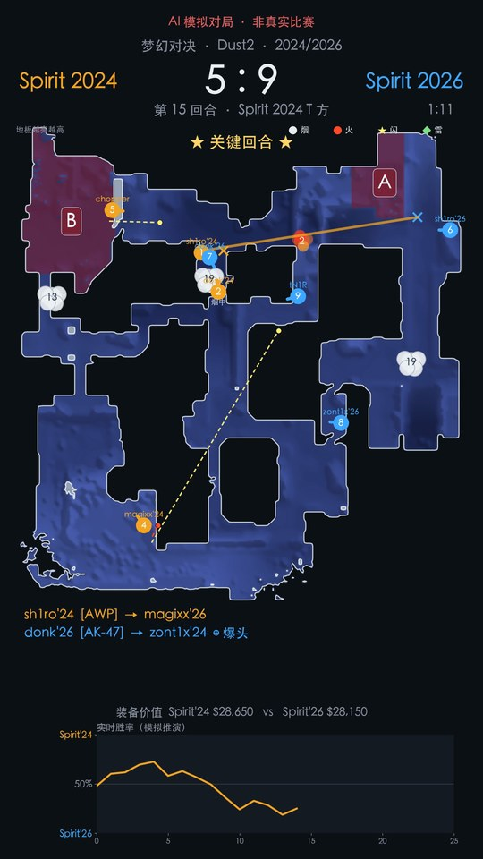
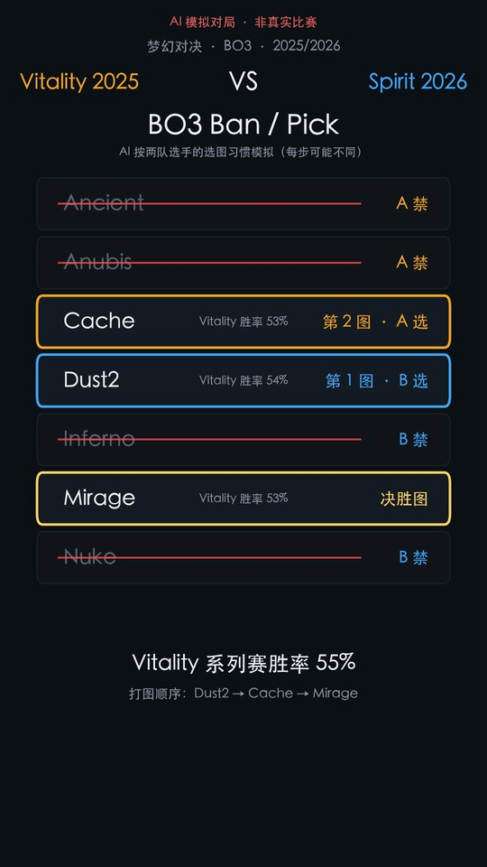
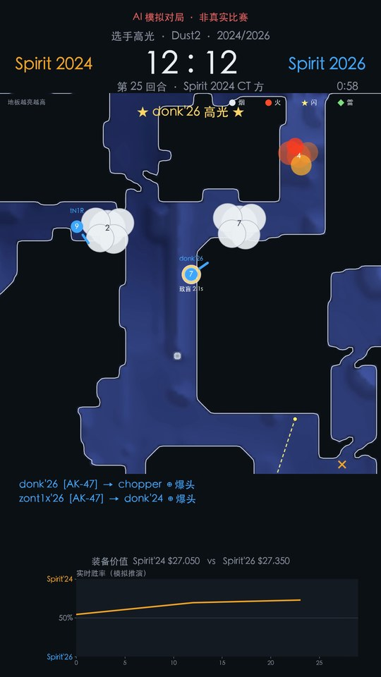

# CS2 梦幻对决模拟器 · CS2 Dream Match

  

**用职业比赛录像学习每名选手、每支战队的打法，模拟任意阵容（包括不同年份）之间的对局，并自动生成 9:16 竖屏的 2D 小地图对战短视频。**

想看 2024 年的 Spirit 打 2026 年的 Spirit？想让 ZywOo、donk、m0NESY 组一队？这个项目可以模拟上万场给出胜率，再挑一场生成一条完整的对战视频：Ban/Pick、走位、道具、对枪、击杀播报、实时胜率，全部按选手在真实比赛里的习惯生成。

> 视频画面全程标注「AI 模拟对局 · 非真实比赛」。本项目与 Valve、HLTV 及任何战队无关，队名和选手名仅用于描述数据。

<p align="center">
  
  
  
</p>
<p align="center"><sub>左：关键回合（烟雾带倒计时、闪光和手雷飞行轨迹、编号徽章、击杀播报）；中：BO3 Ban/Pick 动画；右：选手个人高光（镜头跟随、金色光圈）</sub></p>

---

## English summary

A hierarchical generative simulator for professional *Counter-Strike 2*, trained on about 5,000 S-tier maps (2023–2026, 110k rounds):

- **Round model and match simulation.** Player-year embeddings feed an antisymmetric round model, followed by MR12 Monte Carlo simulation and calibration.
- **Three Transformers.** They generate in-round events, grenades and second-by-second movement, conditioned on the ten players.
- **Data-derived map physics.** Walkability, line of sight, terrain and a library of real duel lines keep shooters able to see their targets, and make players who see each other fight.
- **Veto model.** Map-selection habits are learned from series map order, with unobserved bans treated as latent variables.

The output is a broadcast-style vertical radar video. After training, everything runs offline on a laptop (a Gradio web UI and a CLI). The code is MIT-licensed. Data and trained models are **not** in this repository; the dataset (raw demos and the cleaned tables) is at [weyoung-open-lab/cs2-s-tier-demos](https://github.com/weyoung-open-lab/cs2-s-tier-demos) (see *Data*).

---

## 能做什么

- **梦幻对决**：从 2023–2026 年的选手里任选 5 人对 5 人，同一名选手可以用不同年份分别出现在两边。模拟上万场，给出每张图的胜率、比分分布和加时概率。
- **Ban/Pick**：按两队选手的选图习惯，模拟 BO1 / BO3 / BO5 的禁选流程和系列赛胜率。
- **2D 对战短视频**（9:16 竖屏）：
  - 单张地图、BO1、BO3 全程（开头有 Ban/Pick 动画，最后是系列赛结算），以及选手个人高光：从已经生成的对局视频里剪出某名选手的多杀和残局回合（比分、击杀和原视频完全一样），镜头跟随、击杀慢放。
  - 导播风格小地图：深蓝地板（越亮越高）、墙线、障碍物、暗红包点。
  - 选手是编号徽章，带朝向尖角。
  - 烟雾、火团（都带倒计时）、闪光、手雷，以及 C4 倒计时。
  - 选手状态：被闪致盲、燃烧、烟中、手雷扣血。
  - 击杀播报（标注爆头、穿烟、被闪）和实时胜率曲线。
- **网页界面**（Gradio，本机离线）和**命令行批量出片**。
- **自动更新**：把新的比赛数据放进「收件箱」，会自动清洗、提取、重训。新模型在最新赛事上不比旧模型差才替换，旧模型归档，可以回退。

## 模型

| 模块 | 方法 | 代码 |
|---|---|---|
| 回合胜负 + 整场模拟 | 「选手 × 年份」向量 + 反对称神经网络回合模型（5 个集成），经济按真实数据抽样，MR12 蒙特卡洛，Platt 校准 | `p4_model.py` |
| 回合事件（谁杀谁、在哪、用什么枪、下包） | 6 层 Transformer，指针网络选受害者和攻击者，采样时遵守游戏规则 | `p7_event_model.py` |
| 道具（烟/火/闪/雷：谁扔、何时、落点） | 6 层 Transformer，从 12,885 个真实道具点位中选择，坐标取真实投掷记录 | `p15_utility_model.py` |
| 走位（10 人逐秒位置和朝向） | 6 层 Transformer 解码器，以事件剧本为条件 | `p10_motion.py` |
| 地图物理 | 从真实站位和子弹路线学可走区域、视线和地形；真实枪线库；视野 ±45°；对枪参数从数据统计 | `p13_physics.py` |
| Ban/Pick | 选手选图偏好；数据里没有 ban 记录，把 ban 当作隐变量求边际似然 | `p12_veto.py` |

生成一条视频的流程：

1. 回合模型模拟几百场，得到赛前胜率，并引导每回合的胜负。
2. 事件模型写出每回合的击杀和下包剧本。
3. 道具模型按剧本生成这回合的道具。
4. 走位模型生成逐秒位置，同时遵守地图物理：
   - 不穿墙；
   - 开枪瞬间双方之间有视线；
   - 没有交火安排时，敌我不出现在彼此视野里；
   - 烟雾挡视线，选手不站在火里。
5. 渲染成视频。

## 主要结果

按时间留出最后 4 个赛事做盲测。

| 任务 | 结果 |
|---|---|
| 整场胜负预测（270 张图） | 准确率 **63.3%**，对数损失 0.657；调优后的战队 Elo 为 60.7%、0.714 |
| 事件真实度 | 每回合击杀 6.69 vs 真实 6.51；A 点下包占比 53.5% vs 53.1%；选手 AWP 使用率相关 0.99 |
| 道具 | 每回合烟/火/闪/雷 6.2/4.9/5.8/3.6 vs 真实 6.5/5.0/5.9/3.7；选手道具使用量相关 0.94–0.97 |
| 走位 | 击杀时刻位置误差中位数 571（基线 1522） |
| 风格向量 | 不用角色标签，5 近邻识别角色 66.3%（多数类 28.6%） |
| Ban/Pick（5 折交叉验证） | 两张选图命中 **44.4%**，地图热度基线 33.4%，配对 bootstrap 显著 |
| 地图物理 | 开枪瞬间隔墙 77% → **6%**；没有交火安排却互相看见的情况每回合 147 → **4.9** 对·秒；93% 的枪线贴合真实枪线 |

**如实说明**：控制了选手之后，加入战队向量对回合内战术习惯的提升**不显著**（配对 bootstrap 置信区间包含 0）。我们的解读是：战队的回合内风格很大程度上由它的阵容决定。与之相对，阵容的**选图习惯**可以被显著地学到。

## 数据

本仓库**不包含数据和训练好的模型**。数据集放在单独的仓库 **[weyoung-open-lab/cs2-s-tier-demos](https://github.com/weyoung-open-lab/cs2-s-tier-demos)**（文件在 Releases 里），有数据字典、文件清单、校验码和一个下载脚本：

```bash
git clone https://github.com/weyoung-open-lab/cs2-s-tier-demos.git && cd cs2-s-tier-demos
python download.py clean --out $CS2_DATA   # 清洗后的表（约 1.7 GB），够直接从 p4 开始训练
python download.py raw   --out $CS2_DATA   # 原始数据（约 134 GB），从 p0 开始完整重跑时才需要
```

数据是 2023–2026 年 S 级赛事录像，用 [awpy](https://github.com/pnxenopoulos/awpy) 解析成 Parquet，原始数据约 134 GB，同时以 7 个数据集的形式发布在 Kaggle（作者 `zhangx1ang`）：
`cs2-s-tier-demos-member-a`、`-member-b`、`-member-c`、`-member-d`、`-member-e`、`-member-e2`、`-patch`。

原数据集的使用条款为**仅用于科研**。使用数据，或者用数据训练出来的模型时，请遵守原条款；公开发布生成的视频之前，请自行确认是否符合条款。

## 安装

**Mac（Apple 芯片，用于出片和网页）：**

```bash
git clone https://github.com/coralr-1/cs2-dream-match.git
cd cs2-dream-match
./setup_mac.sh            # 在 ~/cs2sim 建运行环境（Python 3.12 + 依赖），拷贝代码，建「收件箱」「生成的视频」快捷方式
```

改了 `pipeline/` 里的代码后，运行 `./setup_mac.sh --sync` 同步。运行环境放在桌面以外，是因为 macOS 不允许后台定时任务访问「桌面」「文稿」，自动更新需要这样做。

**Linux + NVIDIA GPU（用于训练）：**

```bash
python3.12 -m venv .venv && .venv/bin/pip install -r requirements.txt
export CS2_DATA=/path/to/data          # Kaggle 原始数据（cs2-s-tier-demos-*）解压到这里
```

所有路径都可以用环境变量配置，见 [`pipeline/paths.py`](pipeline/paths.py)。

## 从零训练

在 `pipeline/` 目录下依次运行（`CS2_DATA` 指向数据目录）。一张 RTX 5090 上，全部跑完大约需要几个小时。

```bash
python p0_index.py                 # 扫描原始数据，建索引
python p1_clean.py                 # 清洗：真实回合号、比分校验、战队归属
python p2_features.py              # 每名选手每回合的数据
python p3_profiles.py              # 选手 / 战队画像、站位
python p6_events.py                # 事件序列
python p9_tracks.py                # 逐秒走位
python p14_utility.py              # 道具（烟/火/闪/雷）
python p4_model.py train           # 回合模型 + 整场模拟
CS2_TAG=team2 python p7_event_model.py train
python p12_veto.py train
python p13_physics.py build        # 地图物理 + 对枪统计
python p15_utility_model.py train
python p10_motion.py train
bash train_final.sh                # 评估完成后，用全部数据训练正式模型 → $CS2_DATA/models_final
```

训练好的 `clean/` 表和 `models_final/` 拷到 Mac 的 `~/cs2sim/data/clean`、`~/cs2sim/data/models`，就能离线使用。

## 使用

**网页**：双击 `打开模拟器.command`，浏览器会打开 http://localhost:7860 。有「梦幻对决」「Ban/Pick 模拟」「生成短视频」「选手画像」「战队画像」几个部分，生成时有进度条。

**命令行出片：**

```bash
# 单张地图（战队:年份，自动用当年主力）
./make_video.sh --a vitality:2025 --b spirit:2026 --map de_mirage --out 生成的视频/a.mp4
# 自由组合阵容（选手名:年份）
./make_video.sh --a-players "ZywOo:2025,ropz:2025,flameZ:2025,mezii:2025,apEX:2025" \
                --b-players "donk:2026,sh1ro:2026,zont1x:2026,magixx:2026,tN1R:2026" --map de_inferno --out 生成的视频/b.mp4
# BO3 全程（含 Ban/Pick）
./make_video.sh --a vitality:2025 --b spirit:2026 --series bo3 --out 生成的视频/bo3.mp4
# 选手个人高光：从之前生成的对局里剪（系列赛默认剪全部图，--part 1 只剪第 2 张图）
./make_video.sh --highlight ZywOo:2025 --from 生成的视频/a.mp4 --out 生成的视频/zywoo.mp4
./make_video.sh --highlight donk:2026 --from 生成的视频/bo3.mp4 --part 1 --out 生成的视频/donk_map2.mp4
# 批量（清单格式见 对阵清单示例.csv；map 一列写 bo1/bo3/bo5 时生成系列赛）
./make_video.sh --batch 对阵清单示例.csv --outdir 生成的视频/
```

每条视频同时输出 `.png` 封面和 `.json` 剧本（逐回合事件、道具、比分、数据，方便写文案），对局视频还会存一份 `_tracks.npz` 走位，剪选手高光时直接复用，画面和原视频一致。同一个剧本编号每次生成的结果完全相同。

**自动更新**：运行 `./安装自动更新.sh`，之后每 30 分钟检查一次收件箱；卸载用 `./卸载自动更新.sh`。

更详细的说明见 [`使用说明_出片与自动更新.md`](使用说明_出片与自动更新.md)。

## 目录

```
pipeline/
  p0_index.py … p3_profiles.py   数据索引、清洗、特征、画像
  p4_model.py                    回合模型 + 整场模拟
  p6_events.py, p7_event_model.py   事件序列 + 事件 Transformer
  p9_tracks.py, p10_motion.py    逐秒走位 + 走位 Transformer
  p12_veto.py                    Ban/Pick 模型
  p13_physics.py                 地图物理（视线、可走区域、地形、真实枪线、对枪统计）
  p14_utility.py, p15_utility_model.py   道具提取 + 道具 Transformer
  p11_paper_eval.py              评估指标
  render_video.py                视频渲染（单图 / 系列赛 / 高光）
  p5_app.py                      Gradio 网页
  auto_update.py                 收件箱自动更新
  paths.py                       路径配置
docs/images/                     README 截图
tools/                           自动更新的定时任务模板
setup_mac.sh                     Mac 运行环境安装 / 代码同步
make_video.sh                    命令行出片
打开模拟器.command                双击打开网页
对阵清单示例.csv                  批量出片清单示例
```

## 局限

- 跨年份对局本质上是反事实推测，只反映每名选手各自当年的状态，无法模拟版本更替后的适应。
- 地图物理只用平面坐标（数据里的走位没有高度）。多层地图（如 Nuke）会偏宽松，薄门、木箱分辨不出，烟雾按圆形近似。
- 闪光致盲时长和手雷伤害数据里没有记录，是按游戏机制估算的。
- 剧本时间线来不及拉出视线的极少数击杀，会在击杀播报里标「穿墙」。
- 只覆盖 S 级赛事，出场太少的选手退回通用水平；大部分结果只跑了一次训练，没有测多个随机种子之间的差异。

## 许可证

代码采用 [MIT 许可证](LICENSE)。数据和由数据训练出的模型遵守原数据集的条款（仅用于科研）。
